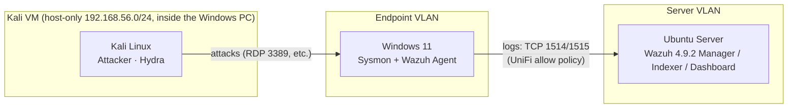

# Home SOC Lab: Detection Engineering with Wazuh

A home Security Operations Center (SOC) lab where I stood up a Wazuh SIEM, generated realistic Windows endpoint telemetry, emulated six attacker techniques from a Kali VM and wrote and tuned custom detection rules; documenting each as a mini incident report with evidence.

**Status:** ✅ Complete — 6/6 scenarios detected with evidence, backed by 11 custom Wazuh rules.

---

## Table of Contents
- [Objectives](#objectives)
- [Lab Architecture](#lab-architecture)
- [Tools and Technologies](#tools-and-technologies)
- [Setup Summary](#setup-summary)
- [Detection Scenarios](#detection-scenarios)
- [Custom Detection Rules](#custom-detection-rules)
- [Key Log Sources](#key-log-sources)
- [Repository Structure](#repository-structure)
- [Lessons Learned](#lessons-learned)
- [Skills Demonstrated](#skills-demonstrated)

---

## Objectives
- Stand up a Wazuh SIEM (manager, indexer, dashboard) and forward Windows endpoint logs to it
- Enrich Windows telemetry with Sysmon and PowerShell Script Block Logging
- Emulate attacker techniques mapped to MITRE ATT&CK in a contained lab
- Write, tune, and validate custom Wazuh detection rules — field matching, correlation, and allow-lists
- Document each investigation as an incident report: timeline, evidence, detection logic, tuning, response

---

## Lab Architecture



The endpoint and server sit on separate UniFi VLANs. A single zone-based firewall policy allows only the endpoint → server traffic the lab needs (TCP 22, 443, 1514, 1515); see [`docs/04-wazuh-agent.md`](docs/04-wazuh-agent.md#1-make-sure-the-endpoint-can-reach-the-manager). The attacker is a Kali VM on a host-only network inside the Windows PC, so all attack traffic stays off the real LAN.

| Host           | OS                     | Role                                                | Specs                                      |
| -------------- | ---------------------- | --------------------------------------------------- | ------------------------------------------ |
| `wazuh-server` | Ubuntu 26.04.1 LTS     | Wazuh 4.9.2 manager, indexer, dashboard (all-in-one) | 8 cores, 30 GB RAM                         |
| `win-endpoint` | Windows 11 Pro         | Monitored endpoint (Sysmon 15.22, Wazuh agent 4.9.2) | Intel Core i9-10900K (10 cores), 64 GB RAM |
| `kali`         | Kali Linux 2026.2      | Attacker (VM on the Windows host, host-only `192.168.56.0/24`) | 4 GB RAM, 2 vCPU (VirtualBox)    |

---

## Tools and Technologies
| Category               | Tools                                                                                                   |
| ---------------------- | ------------------------------------------------------------------------------------------------------- |
| SIEM                   | Wazuh 4.9.2 (manager, indexer, dashboard)                                                               |
| Endpoint telemetry     | Sysmon ([SwiftOnSecurity config](https://github.com/SwiftOnSecurity/sysmon-config), customized), Windows Event Logs, PowerShell Script Block Logging |
| Attack simulation      | Kali Linux (Hydra), targeted proof-of-concept scripts                                                   |
| Detection engineering  | Wazuh XML rules — PCRE2 field matching, `frequency`/`timeframe` correlation, `same_field`, allow-lists   |
| Framework              | MITRE ATT&CK                                                                                             |
| Virtualization / network | VirtualBox, UniFi VLAN segmentation, host-only VM isolation                                           |

---

## Setup Summary
Detailed, reproducible steps are in [`docs/`](docs/). High level:

1. ✅ **Wazuh server:** installed on Ubuntu with the all-in-one installer → [`docs/01-wazuh-install.md`](docs/01-wazuh-install.md)
2. ✅ **Windows logging:** enabled Advanced Audit Policy, process command-line auditing, and PowerShell Script Block Logging → [`docs/02-windows-logging.md`](docs/02-windows-logging.md)
3. ✅ **Sysmon:** installed with the SwiftOnSecurity config ([`configs/sysmonconfig.xml`](configs/sysmonconfig.xml)), later customized to monitor LSASS access → [`docs/03-sysmon.md`](docs/03-sysmon.md)
4. ✅ **Wazuh agent:** opened the inter-VLAN path and enrolled the Windows endpoint via the dashboard deploy wizard → [`docs/04-wazuh-agent.md`](docs/04-wazuh-agent.md)

Pipeline verified end to end: a deliberate failed logon (Event 4625) on the endpoint appears in Wazuh as an "Authentication failure" alert within a minute.

<details>
<summary>Sysmon channel added to the Wazuh agent's <code>ossec.conf</code></summary>

```xml
<localfile>
  <location>Microsoft-Windows-Sysmon/Operational</location>
  <log_format>eventchannel</log_format>
</localfile>
```
</details>

---

## Detection Scenarios

Each scenario is an attack executed in the lab plus a full write-up in [`scenarios/`](scenarios/): attack, timeline, evidence (Windows/Sysmon + Wazuh alerts with screenshots), detection logic, tuning notes, and response.

| # | Scenario                     | MITRE ATT&CK | Detection outcome |
| - | ---------------------------- | ------------ | ----------------- |
| 1 | [RDP brute force](scenarios/01-rdp-brute-force.md) | [T1110.001](https://attack.mitre.org/techniques/T1110/001/), [T1078](https://attack.mitre.org/techniques/T1078/) | Default rules missed the pattern; **custom correlation rules** flag the burst (L10) and the cracked-account success (L12) |
| 2 | [Encoded PowerShell execution](scenarios/02-encoded-powershell.md) | [T1059.001](https://attack.mitre.org/techniques/T1059/001/), [T1027](https://attack.mitre.org/techniques/T1027/) | Custom rule at L12 + **allow-list** to suppress a real benign source of encoded PowerShell |
| 3 | [LSASS credential access](scenarios/03-lsass-credential-dumping.md) | [T1003.001](https://attack.mitre.org/techniques/T1003/001/) | Dump **prevented** by LSA Protection; closed a Sysmon telemetry gap; custom rules L12 |
| 4 | [Local admin account created](scenarios/04-local-admin-account.md) | [T1136.001](https://attack.mitre.org/techniques/T1136/001/), [T1098](https://attack.mitre.org/techniques/T1098/) | Caught by built-in rules; admin-group change correctly rated L12 |
| 5 | [Scheduled task persistence](scenarios/05-scheduled-task-persistence.md) | [T1053.005](https://attack.mitre.org/techniques/T1053/005/) | Default alerts only L3–4; **custom rules** raise L10 and L12 |
| 6 | [Security log cleared](scenarios/06-security-log-cleared.md) | [T1070.001](https://attack.mitre.org/techniques/T1070/001/) | Default L5; **custom rules** raise two L12 alerts |

---

## Custom Detection Rules

All 11 rules live in [`rules/local_rules.xml`](rules/local_rules.xml) (IDs in the `100xxx` range) and run on the manager. Highlights:

- **Correlation** (Scenario 1): `frequency` + `timeframe` + `same_field` to count failed logons per source IP and flag a success that follows them — working around the fact that Windows logon events populate `win.eventdata.ipAddress`, not `srcip`.
- **Allow-listing** (Scenario 2): a level-0 child rule that suppresses a known-good source of encoded PowerShell by its full signed path, so an impostor binary elsewhere still alerts.
- **Severity escalation** (Scenarios 5, 6): child rules on built-in detections that promote high-signal events (hidden SYSTEM scheduled tasks, cleared Security log) from L3–5 to L12.
- **Telemetry + detection** (Scenario 3): enabled Sysmon Event 10 for LSASS (off by default) and wrote rules for credential-dumping access masks and for interpreters touching LSASS.

Every rule was validated with `wazuh-analysisd -t` and confirmed firing against real events in the dashboard.

---

## Key Log Sources
| Source                 | Event ID    | Why it matters                                |
| ---------------------- | ----------- | --------------------------------------------- |
| Security               | 4624 / 4625 | Successful / failed logon                     |
| Security               | 4672        | Privileged logon                              |
| Security               | 4688        | Process creation (with command line)          |
| Security               | 4720 / 4732 | Account created / added to a group            |
| Security               | 4698        | Scheduled task created                        |
| Security               | 1102        | Audit log cleared                             |
| System                 | 7045        | New service installed                         |
| PowerShell/Operational | 4104        | Script block content (decoded)                |
| Sysmon                 | 1           | Process create (hashes, parent, command line) |
| Sysmon                 | 3           | Network connection                            |
| Sysmon                 | 10          | Process access (LSASS)                        |
| Sysmon                 | 11 / 13     | File create / registry value set              |
| Sysmon                 | 22          | DNS query                                     |

---

## Repository Structure
```
Home-SOC-Lab/
├── README.md
├── docs/            # step-by-step setup guides (01–04)
├── scenarios/       # one incident write-up per scenario (01–06)
├── rules/           # Wazuh custom rules (local_rules.xml)
├── configs/         # customized Sysmon config
└── screenshots/     # dashboard evidence per scenario
```

---

## Lessons Learned

**The agent couldn't reach the server, and it wasn't the server's fault.** After the Wazuh install passed every health check, the Windows endpoint still couldn't load the dashboard. Testing from the endpoint showed every port (22, 443, 1514, 1515) timing out, and ping failing too. `ufw` was inactive on the server, and Ubuntu answers ping by default, so the block had to be in the network: the two machines were on separate UniFi VLANs with inter-VLAN traffic denied. Rather than flattening the network, I added one zone-based firewall policy allowing only the endpoint's IP to reach the server's IP on the four ports the lab needs. Lesson: test reachability layer by layer (ping, then ports) from the client side before touching the service, and open the narrowest path that works.

**Default rules saw the persistence but didn't care; my first custom rule didn't match.** In Scenario 5, Wazuh logged a hidden SYSTEM-level scheduled task at only level 3–4, and Sysmon's best evidence produced no alert at all. I wrote two custom rules. One fired straight away; the other never matched, because Wazuh stores the task XML HTML-encoded (`Command&gt;powershell.exe`), not as it appears in Windows. Pulling the real alert from `alerts.json` showed the actual format, and a tolerant pattern fixed it. Lesson: write and test rules against the data as the SIEM stores it, and confirm the rule is actually deployed before debugging its logic.

**My own tooling was a false positive.** While building the encoded-PowerShell detection (Scenario 2), Sysmon showed encoded `pwsh` commands every few minutes that I hadn't run — from the AI coding assistant I used to build the lab, which runs its PowerShell calls with `-EncodedCommand`. The Wazuh agent's own configuration checks also tripped a PowerShell rule. Rather than lowering severity, I added a level-0 child rule that allow-lists the assistant by its full install path, so an impostor binary elsewhere still alerts. Lesson: baseline what's normal on the host before trusting a rule, and make exceptions as narrow as the evidence allows.

**The built-in brute-force rule was watching the wrong field.** In Scenario 1, Hydra's RDP attack produced individual failure alerts (L5) and a success (L6), but no "brute force" alert. Two reasons: the default composite rule needs ~8 failures, and it correlates on `srcip` — which is **empty** for Windows logon events, where the attacker IP actually lands in `win.eventdata.ipAddress`. I confirmed the field in `alerts.json`, then wrote correlation rules (`frequency`/`timeframe` + `same_field`) that count failures per source IP and flag a success following them as a likely cracked account (L12). Lesson: a rule that "exists" isn't a detection — verify it keys on a field your data actually populates.

**The endpoint sensor wasn't watching the thing I most wanted to detect.** For LSASS credential access (Scenario 3), the key signal is Sysmon Event 10 (process access to `lsass.exe`) — but the stock SwiftOnSecurity config ships that disabled for performance. So before any rule could help, there was no data. I enabled `ProcessAccess` for LSASS (excluding the legitimate system accessors) and confirmed it captured a test access. Lesson: deploying a sensor isn't the same as collecting the right telemetry; audit the config against the specific techniques you care about.

**Prevention changed what detection could even see.** The LSASS dump attempt was blocked outright by LSA Protection (`RunAsPPL=2`, on by default on this Windows 11 build) — and the blocked attempt produced *no* Sysmon event at all, because the handle was denied before it existed. So on a protected host, the useful detection shifts upstream: watch for attempts to *disable* LSA Protection or load a vulnerable driver, rather than the dump itself. Understanding where a control sits changed the detection design.

**A critical vulnerability in the news is a prompt to check your own inventory.** During setup, the "PHP2Shell" flaws (CVE-2026-109618/-109619) took websites offline worldwide. A quick check (`php -v` on the server, PATH and install folders on the endpoint) confirmed no PHP anywhere in the lab, so no action was needed — but Wazuh's Vulnerability Detection module separately flagged 2 High findings on the endpoint to work through.

---

## Skills Demonstrated
- SIEM deployment and log-pipeline engineering (Wazuh manager/indexer/dashboard + agent)
- Windows Event Log, PowerShell, and Sysmon telemetry engineering — including tuning the Sysmon config to close a visibility gap
- **Detection engineering in Wazuh:** PCRE2 field matching, correlation (`frequency`/`timeframe`/`same_field`), severity escalation, and allow-listing
- Adversary emulation with Kali Linux / Hydra, mapped to MITRE ATT&CK
- Alert triage and incident documentation (timeline, evidence, tuning, response)
- Network segmentation and troubleshooting (UniFi VLANs, host-only VM isolation)
- Understanding of endpoint hardening (LSA Protection, Credential Guard) and how prevention shapes detection

---

## Disclaimer
All attacks were performed in an isolated lab against systems I own. Do not use these techniques against systems you are not authorized to test.
