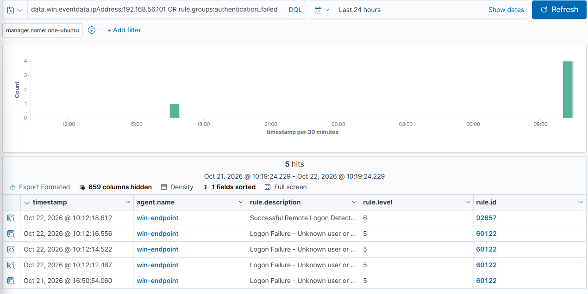
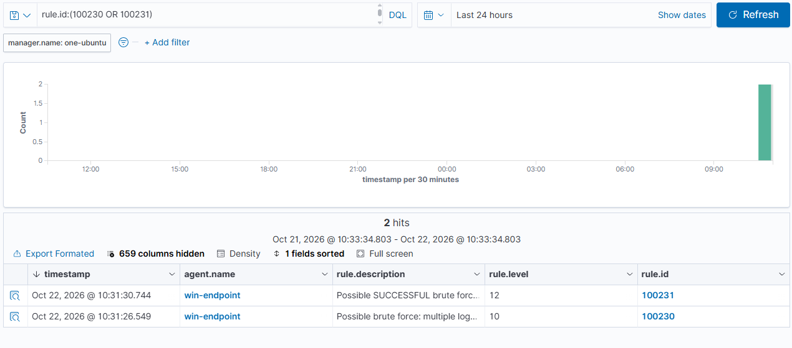

# Scenario 1 · RDP Brute Force

| | |
| --- | --- |
| **MITRE ATT&CK** | [T1110.001](https://attack.mitre.org/techniques/T1110/001/) Brute Force: Password Guessing · [T1078](https://attack.mitre.org/techniques/T1078/) Valid Accounts |
| **Attacker** | Kali Linux VM (`192.168.56.101`), Hydra |
| **Target** | `win-endpoint` (`192.168.56.1`), RDP / port 3389 |
| **Date** | 2026-10-22 |
| **Result** | ⚠️ Defaults: individual failures (L5) + success (L6), **no brute-force alert** → ✅ **two correlation rules** at L10 and L12 |

---

## Summary

An attacker guesses an account's password by trying many over RDP. The danger isn't any single failed logon (users mistype), it's the **pattern**: a burst of failures, then a success, from one source.

I ran Hydra from a Kali VM against the endpoint's RDP. Windows and Wazuh logged every attempt, but the built-in rules scored them as isolated events (failures L5, success L6) and **never raised a "brute force" alert** — the default threshold is ~8 failures and our burst was smaller. Worse, the most important event, a success straight after failures from the same IP, was only **level 6**.

Two things also blocked the built-in correlation: the default rule keys on `srcip`, but Windows logon events store the attacker IP in `win.eventdata.ipAddress`, leaving `srcip` empty. I wrote two custom rules that correlate on the real field: one for a brute force in progress (L10), one for a likely-successful brute force (L12).

---

## Lab setup

Kali runs as a VM on the Windows host, on a **host-only** network (`192.168.56.0/24`) so all attack traffic stays inside the PC — off the real LAN.

- VirtualBox VM: Kali 2026.2, Adapter 1 = NAT (updates), Adapter 2 = Host-only (attack path).
- Target prep (elevated PowerShell, **reverted after the test**):
  ```powershell
  Set-ItemProperty "HKLM:\System\CurrentControlSet\Control\Terminal Server" -Name fDenyTSConnections -Value 0
  Enable-NetFirewallRule -DisplayGroup "Remote Desktop"
  net user rdptest 'Summer2026!' /add
  net localgroup "Remote Desktop Users" rdptest /add
  ```
- Reachability from Kali: `ping 192.168.56.1` (0% loss), `nc -zv 192.168.56.1 3389` (open).

---

## Attack

```bash
cat > ~/passlist.txt <<'EOF'
Password1
Welcome1
Admin123
Qwerty123
Letmein1
Summer2026!
EOF
hydra -t 1 -V -l rdptest -P ~/passlist.txt rdp://192.168.56.1
```

Result: 5 failures, then `login: rdptest  password: Summer2026!`. `-t 1` (one thread) because RDP is unreliable with parallel attempts.

## Cleanup (done)

```powershell
net user rdptest /delete
Set-ItemProperty "HKLM:\System\CurrentControlSet\Control\Terminal Server" -Name fDenyTSConnections -Value 1
Disable-NetFirewallRule -DisplayGroup "Remote Desktop"
```
Verified: 3389 no longer listening, `rdptest` gone, RDP firewall rules disabled.

---

## Evidence

### Endpoint (Windows Security log)

| Event | Meaning                     | Key fields                                              |
| ----- | --------------------------- | ------------------------------------------------------- |
| 4625  | Failed logon (×5)           | `TargetUserName=rdptest`, `IpAddress=192.168.56.101`    |
| 4624  | Successful logon            | `LogonType=10` (RemoteInteractive), `IpAddress=192.168.56.101` |

> First run (3 failures) confirmed Windows logs Logon Type 10 from the Kali IP; the write-up uses the second run (5 failures) that crosses the in-progress threshold.

### Wazuh: built-in rules only (before)

| Rule  | Level | Description                                   |
| ----- | ----- | --------------------------------------------- |
| 60122 | 5     | Logon Failure - Unknown user or bad password (per attempt) |
| 92657 | 6     | Successful Remote Logon Detected              |

No composite/brute-force alert fired. Built-in rule 60204 ("Multiple Windows Logon Failures") needs more failures **and** relies on `srcip`, which is empty here.



### Wazuh: with custom rules (after)

| Timestamp    | Rule       | Level  | Description                                                                       |
| ------------ | ---------- | ------ | --------------------------------------------------------------------------------- |
| 10:31:26.549 | **100230** | **10** | Possible brute force: multiple logon failures from `192.168.56.101` targeting `rdptest` |
| 10:31:30.744 | **100231** | **12** | Possible SUCCESSFUL brute force: logon success for `rdptest` from `192.168.56.101` after repeated failures |



---

## Detection

### Wazuh custom rules ([`rules/local_rules.xml`](../rules/local_rules.xml))

```xml
<group name="local,windows,authentication_failures,">

  <!-- Brute force in progress: repeated failures from one source IP. -->
  <rule id="100230" level="10" frequency="4" timeframe="120">
    <if_matched_sid>60122</if_matched_sid>
    <same_field>win.eventdata.ipAddress</same_field>
    <description>Possible brute force: multiple logon failures from $(win.eventdata.ipAddress) targeting $(win.eventdata.targetUserName)</description>
    <mitre><id>T1110.001</id></mitre>
  </rule>

  <!-- Success from an IP that just produced repeated failures = likely cracked. -->
  <rule id="100231" level="12" frequency="2" timeframe="300">
    <if_sid>92657</if_sid>
    <if_matched_sid>60122</if_matched_sid>
    <same_field>win.eventdata.ipAddress</same_field>
    <description>Possible SUCCESSFUL brute force: logon success for $(win.eventdata.targetUserName) from $(win.eventdata.ipAddress) after repeated failures</description>
    <mitre><id>T1110.001</id><id>T1078</id></mitre>
  </rule>

</group>
```

**These are correlation rules, not single-event rules:**
- `frequency` + `timeframe` = "this many matching events within this many seconds."
- `if_matched_sid` = the historical events to count (the failures, 60122).
- `same_field win.eventdata.ipAddress` = only count events sharing the **same source IP** — the fix for the empty-`srcip` problem.
- 100231 adds `if_sid 92657`: the triggering event must be the **success**, with failures from the same IP already seen.

### Sentinel (KQL, planned)

```kql
SecurityEvent
| where EventID in (4624, 4625) and AccountType == "User"
| summarize Failures = countif(EventID == 4625),
            Successes = countif(EventID == 4624),
            Accounts = make_set(TargetAccount)
          by IpAddress, bin(TimeGenerated, 5m)
| where Failures >= 4 and Successes >= 1      // failures then a success from the same IP
| order by TimeGenerated desc
```

---

## Analysis and Tuning

- **The gap was the correlation, not the raw events.** Windows and Wazuh saw every attempt; the defaults just never connected "many failures + a success + same IP" into one high-severity alert.
- **`srcip` vs `win.eventdata.ipAddress`.** Verifying the stored field in `alerts.json` (lesson carried over from Scenario 5) was the whole ballgame: the built-in `same_source_ip` silently matches nothing for Windows logon events. `same_field` on the real field is the fix.
- **Thresholds are a tuning dial:**
  - 100230 `frequency="4"` catches a burst while ignoring the odd mistyped password. Raise it on noisy servers; lower it for very sensitive accounts.
  - 100231 `frequency="2"` is deliberately sensitive — a success after even a couple of failures from one IP is worth a look. False positives: a user who fat-fingers twice then logs in. Mitigate by excluding trusted internal IPs/subnets, or by raising the count for interactive networks.
- **Logon Type matters.** The success was Type 10 (RemoteInteractive/RDP). A future refinement: scope 100231 to remote logon types, or raise severity further when the source is outside the LAN.
- **Extensions:** add Account Lockout (4740) as a corroborating signal; feed these alerts to Wazuh **active response** to auto-block the source IP (`firewall-drop`); extend the same pattern to SMB (Logon Type 3) and to failed Kerberos pre-auth.

---

## Response (if this were real)

1. Confirm the success: did `rdptest` log on from `192.168.56.101` after the failure burst? (100231 says yes.)
2. **Contain:** disable/reset the account, kill the RDP session, block the source IP at the firewall.
3. **Scope:** what did that session do next? Pivot to Sysmon (1/3), process creation (4688), new accounts (4720), and the other scenarios' signals from that logon.
4. **Harden:** enforce account lockout, strong passwords/MFA, restrict RDP exposure (VPN/Network Level Authentication), and consider rate-limiting at the firewall.
