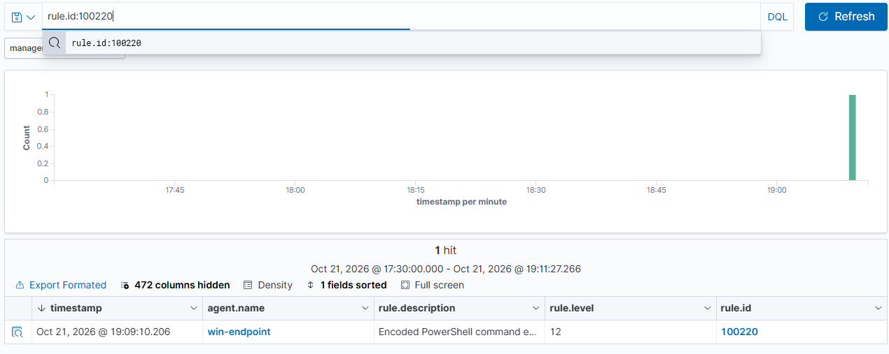

# Scenario 2 · Encoded PowerShell Execution

| | |
| --- | --- |
| **MITRE ATT&CK** | [T1059.001](https://attack.mitre.org/techniques/T1059/001/) Command and Scripting Interpreter: PowerShell · [T1027](https://attack.mitre.org/techniques/T1027/) Obfuscated Files or Information |
| **Target** | `win-endpoint` (Windows 11 Pro) |
| **Date** | 2026-10-21 |
| **Result** | ⚠️ Default rules: level 3 → ✅ **custom rule** at level 12, with an allow-list for a real false-positive source |

---

## Summary

Attackers Base64-encode PowerShell commands (`-enc`) so a glance at the command line reveals nothing. I ran a harmless encoded command with typical attacker flags (`-nop -ep bypass -enc`).

The endpoint captured it three ways: Sysmon recorded the encoded command line, **Script Block Logging (4104) recorded the decoded script**, and the payload's output file appeared. Wazuh's built-in rules scored it **level 3**.

While investigating I found a real **false-positive source on this machine**: Claude Code, the AI coding tool I used to build the lab, runs its own PowerShell commands as `pwsh -EncodedCommand`. A naive "alert on -enc" rule would fire constantly. The custom rule alerts at level 12 and allow-lists that one tool by its **full install path**.

---

## Setup

Script Block Logging was already on ([guide 02](../docs/02-windows-logging.md)), but the Wazuh agent wasn't collecting the PowerShell log. Added to the agent's `ossec.conf` (elevated PowerShell), then restarted it:

```powershell
$conf = "${env:ProgramFiles(x86)}\ossec-agent\ossec.conf"
Copy-Item $conf "$conf.bak2" -Force
Add-Content $conf @"

<ossec_config>
  <localfile>
    <location>Microsoft-Windows-PowerShell/Operational</location>
    <log_format>eventchannel</log_format>
  </localfile>
</ossec_config>
"@
Restart-Service WazuhSvc
```

Agent log confirmed: `Analyzing event log: 'Microsoft-Windows-PowerShell/Operational'`.

---

## Attack

```powershell
$cmd = 'Write-Output "Lab test: encoded PowerShell ran at $(Get-Date)" | Out-File C:\Temp\enc-test.txt'
$enc = [Convert]::ToBase64String([Text.Encoding]::Unicode.GetBytes($cmd))
powershell.exe -nop -ep bypass -enc $enc
```

| Flag          | Meaning                          |
| ------------- | -------------------------------- |
| `-nop`        | Skip the user's profile          |
| `-ep bypass`  | Ignore execution policy          |
| `-enc <b64>`  | Run a Base64 (UTF-16LE) command  |

Real attacks usually add `-w hidden`; omitted here because it would hide the operator's own console.

## Cleanup

```powershell
Remove-Item C:\Temp\enc-test.txt
```

---

## Timeline (Pacific Time)

| Time     | Event                                                                                    |
| -------- | ---------------------------------------------------------------------------------------- |
| 19:02:35 | Agent restarted, now reading the PowerShell log                                          |
| 19:02:38 | Agent's own SCA checks run PowerShell → Wazuh **91816 L4** (benign, not the attack)      |
| 19:03:15 | **Attack.** Sysmon 1 `powershell.exe -nop -ep bypass -enc VwBy...`; Wazuh **67027 L3** only |
| 19:03:16 | **4104** decoded script logged; payload wrote `C:\Temp\enc-test.txt`                     |
| ~19:05   | Found Claude Code launching `pwsh -EncodedCommand` (parent `claude.exe`) every few minutes |
| ~19:08   | Rules 100220 / 100221 deployed (`RULES OK`)                                               |
| 19:09:10 | Attack re-run → **100220 L12**                                                            |
| 19:10:42 | Claude Code encoded command (after deploy) → **no alert** (100221 allow-list)             |
| 19:11:27 | Dashboard confirms exactly 1 hit for 100220                                               |

---

## Evidence

### Endpoint

| Source                 | Event | Key fields                                                                                  |
| ---------------------- | ----- | ------------------------------------------------------------------------------------------- |
| Sysmon                 | 1     | `"...\powershell.exe" -nop -ep bypass -enc VwByAGkAdABlAC0ATwB1AHQA...`, parent `pwsh.exe`   |
| PowerShell/Operational | 4104  | **Decoded:** `Write-Output "Lab test: encoded PowerShell ran at $(Get-Date)" \| Out-File C:\Temp\enc-test.txt` |
| Security               | 4688  | Same process launch                                                                          |
| File                   | —     | `C:\Temp\enc-test.txt`: `Lab test: encoded PowerShell ran at 10/21/2026 19:03:16`            |

The Base64 decodes (UTF-16LE) to exactly the 4104 text: the obfuscation hides nothing from Script Block Logging.

### Wazuh: built-in rules only (before)

| Timestamp    | Rule  | Level | Description                                          | Source                        |
| ------------ | ----- | ----- | ---------------------------------------------------- | ----------------------------- |
| 19:03:14.856 | 67027 | 3     | A process was created.                               | The attack (4688)             |
| 19:02:39.076 | 91816 | 4     | Powershell script querying system environment variables | **Wazuh agent's SCA check** |
| 17:59:00     | 67027 | 3     | A process was created. (×2)                          | Claude Code commands          |

### Wazuh: with custom rules (after)

| Timestamp    | Rule       | Level  | Description                                                              |
| ------------ | ---------- | ------ | ------------------------------------------------------------------------ |
| 19:09:10.206 | **100220** | **12** | Encoded PowerShell command executed by `Owner`, parent `C:\Program Files\PowerShell\7\pwsh.exe` |

Search window 17:30–19:11:27 (covers the 19:10:42 Claude Code run): **1 hit**.



---

## Detection

### Wazuh custom rules ([`rules/local_rules.xml`](../rules/local_rules.xml))

```xml
<group name="local,windows,execution,">

  <!-- Sysmon 1: PowerShell with an encoded command (-e, -ec, -en..., -enc, -EncodedCommand, /enc) + Base64 blob. -->
  <rule id="100220" level="12">
    <if_group>sysmon_event1</if_group>
    <field name="win.eventdata.image" type="pcre2">(?i)\\(powershell|pwsh)\.exe$</field>
    <field name="win.eventdata.commandLine" type="pcre2">(?i)\s[-/](e|ec|en[a-z]*)\s+[A-Za-z0-9+/]{20,}={0,2}</field>
    <description>Encoded PowerShell command executed by $(win.eventdata.user), parent $(win.eventdata.parentImage)</description>
    <mitre><id>T1059.001</id><id>T1027</id></mitre>
  </rule>

  <!-- Allow-list Claude Code by full install path (any version). -->
  <rule id="100221" level="0">
    <if_sid>100220</if_sid>
    <field name="win.eventdata.parentImage" type="pcre2">(?i)\\\.vscode\\extensions\\anthropic\.claude-code-[^\\]+\\resources\\native-binary\\claude\.exe$</field>
    <description>Encoded PowerShell from allow-listed automation (Claude Code)</description>
  </rule>

</group>
```

Regex-tested before deployment:

| Input                                              | 100220 | 100221 |
| -------------------------------------------------- | ------ | ------ |
| `powershell.exe -nop -ep bypass -enc VwBy...`      | match  | —      |
| `-EncodedCommand`, `-e`, `/enc`, `-ec` variants    | match  | —      |
| `powershell -ep bypass -File backup.ps1`           | no     | —      |
| `powershell -ExecutionPolicy RemoteSigned ...`     | no     | —      |
| Parent = Claude Code at its real path              | —      | match (silenced) |
| Parent = `C:\Users\Public\claude.exe` (impostor)   | —      | no (still alerts) |

**How the allow-list works:** a child rule (`if_sid 100220`) that matches replaces its parent; at **level 0** it produces no alert.

### Sentinel (KQL, planned)

```kql
Event
| where Source == "Microsoft-Windows-Sysmon" and EventID == 1
| extend Image = extract(@"<Data Name=""Image"">([^<]+)", 1, EventData),
         CommandLine = extract(@"<Data Name=""CommandLine"">([^<]+)", 1, EventData),
         ParentImage = extract(@"<Data Name=""ParentImage"">([^<]+)", 1, EventData)
| where Image matches regex @"(?i)\\(powershell|pwsh)\.exe$"
| where CommandLine matches regex @"(?i)\s[-/](e|ec|en[a-z]*)\s+[A-Za-z0-9+/]{20,}"
| where not(ParentImage matches regex @"(?i)\\anthropic\.claude-code-[^\\]+\\resources\\native-binary\\claude\.exe$")
| project TimeGenerated, Computer, ParentImage, CommandLine
```

---

## Analysis and Tuning

- **Severity gap in defaults (again).** Obfuscated PowerShell with `-ep bypass` is a textbook attacker pattern, scored level 3 out of the box.
- **Real false positives found, not imagined.** Two benign sources of "suspicious" PowerShell showed up on this endpoint within minutes:
  1. **Claude Code** runs every PowerShell tool call as `pwsh -EncodedCommand`.
  2. **The Wazuh agent's own SCA** runs PowerShell (`secedit /export`, `Get-ADDefaultDomainPasswordPolicy`) and tripped built-in rule 91816.

  In a real SOC these would be RMM agents, deployment tools, and security products. The fix is a narrow allow-list, not a lower severity.
- **Allow-list by path, not name.** Matching only `claude.exe` would let an attacker name their binary `claude.exe`. Pinning the full extension path keeps the exception tight; the version segment is a wildcard so updates don't break it. A stronger version would also check the binary's signature or hash (Sysmon `Hashes`).
- **Decoding is free with 4104.** Script Block Logging recorded the plain-text script, so an analyst never has to decode Base64 by hand. That's why the PowerShell log is now collected.
- **Limitation:** 4104 covers Windows PowerShell 5.1 (`powershell.exe`). PowerShell 7 (`pwsh.exe`) logs to `PowerShellCore/Operational` and needs its own policy. Rule 100220 still catches encoded `pwsh` via Sysmon.
- **Extensions:** a 4104 rule for high-risk script content (`IEX`, `DownloadString`, `FromBase64String`, `-bxor`, AMSI bypass strings); alert on `-w hidden` combined with `-enc` at a higher level.

---

## Response (if this were real)

1. Pull the matching **4104** event(s) to read the decoded script and judge intent.
2. Walk the process tree from Sysmon 1 (`ParentImage`, `ParentCommandLine`) to the origin: user, document, scheduled task, or remote session.
3. Check for follow-on activity from that PowerShell process: Sysmon 3 (network), 11 (files), 13 (registry).
4. Contain the host if the script downloaded or executed anything further.
