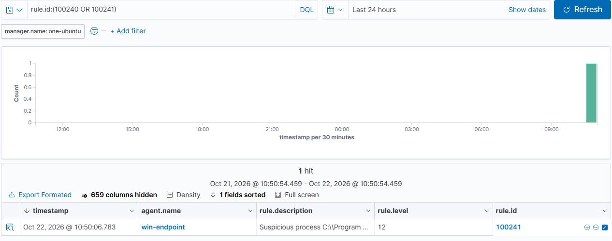

# Scenario 3 · LSASS Credential Access

| | |
| --- | --- |
| **MITRE ATT&CK** | [T1003.001](https://attack.mitre.org/techniques/T1003/001/) OS Credential Dumping: LSASS Memory |
| **Target** | `win-endpoint` (Windows 11 Pro) |
| **Date** | 2026-10-22 |
| **Result** | 🛡️ Dump **prevented** by LSA Protection · 🔎 telemetry gap closed · ✅ custom rules; 100241 fired (L12) |

---

## Summary

`lsass.exe` holds credential material (hashes, Kerberos tickets) for logged-on users. Dumping it (Mimikatz, procdump, `comsvcs.dll MiniDump`) is one of the most common post-exploitation steps. The detection signal is **Sysmon Event 10 (ProcessAccess)**: a process opening a handle into LSASS with read/dump rights.

This scenario produced three findings, and no real credentials were ever dumped:

1. **Prevention works.** A dump-style handle open was **blocked by LSA Protection** (`RunAsPPL=2`) with Access Denied — even from an elevated admin.
2. **Telemetry was off.** The stock SwiftOnSecurity Sysmon config **disables Event 10**, so LSASS access was invisible. I enabled it.
3. **Detection works.** Two custom rules now flag suspicious LSASS access; a benign probe fired rule 100241 at level 12.

> **Method note:** real dumpers write a file full of live credentials and are deleted by Defender. Instead of running one on a production endpoint, I used `OpenProcess` to request a handle to LSASS and immediately closed it — same telemetry, **no dump, no credential material written to disk.**

---

## Environment check (before)

```powershell
(Get-ItemProperty 'HKLM:\SYSTEM\CurrentControlSet\Control\Lsa').RunAsPPL          # 2  -> LSA Protection ON
(Get-MpComputerStatus).RealTimeProtectionEnabled                                   # True -> Defender on
# Credential Guard: not running (SecurityServicesRunning = 0)
```

`RunAsPPL=2` = LSA Protection enabled (default on this Windows 11 build). Sysmon was running, but its config had `ProcessAccess` empty → **no Event 10 at all**.

---

## Attack (safe probe)

Elevated PowerShell, requesting the classic dumper access `PROCESS_VM_READ | PROCESS_QUERY_INFORMATION` (`0x410`):

```powershell
# (P/Invoke OpenProcess on lsass, handle closed immediately — see repo)
$h = [LsassTest]::OpenProcess(0x410, $false, (Get-Process lsass).Id)
# -> OpenProcess blocked, Win32 error 5 (Access Denied)
```

**Result: blocked.** LSA Protection denied the read, and — notably — **no Sysmon Event 10 was generated**: the request was refused before a handle existed.

A second probe requested query-only access (`0x1000`, what `tasklist` uses), which LSA Protection permits:

```powershell
$h = [LsassProbe]::OpenProcess(0x1000, $false, (Get-Process lsass).Id)   # succeeds
# -> Sysmon Event 10: SourceImage=pwsh.exe TargetImage=lsass.exe GrantedAccess=0x1000
```

| Access requested            | Outcome                 | Sysmon Event 10 |
| --------------------------- | ----------------------- | --------------- |
| `0x410` (VM_READ, dumper)   | **Blocked** (error 5)   | **none**        |
| `0x1000` (query-limited)    | Allowed                 | logged          |

No cleanup needed: nothing written, handles closed. The Sysmon config change is a permanent improvement and was kept.

---

## Enabling the telemetry

The stock config disabled Event 10 ([`configs/sysmonconfig.xml`](../configs/sysmonconfig.xml), the empty `ProcessAccess` include). Replaced with: include access to `lsass.exe`, exclude the legitimate high-volume accessors (svchost, wininit, services, csrss, lsass, Defender's MsMpEng/MsSense…).

```xml
<RuleGroup name="LSASS access" groupRelation="or">
  <ProcessAccess onmatch="include">
    <TargetImage condition="image">lsass.exe</TargetImage>
  </ProcessAccess>
</RuleGroup>
<RuleGroup name="LSASS access noise" groupRelation="or">
  <ProcessAccess onmatch="exclude">
    <SourceImage condition="image">svchost.exe</SourceImage>
    <!-- …wininit, services, csrss, lsass, MsMpEng, MsSense, SenseIR, SenseNdr, wmiprvse… -->
  </ProcessAccess>
</RuleGroup>
```

Applied with `Sysmon64.exe -c sysmonconfig.xml` ("Configuration updated"). Confirmed working: the `0x1000` probe produced an Event 10.

---

## Detection

### Wazuh custom rules ([`rules/local_rules.xml`](../rules/local_rules.xml))

```xml
<group name="local,windows,credential_access,">

  <!-- Classic credential-dumping access masks against lsass. -->
  <rule id="100240" level="12">
    <if_group>sysmon_event_10</if_group>
    <field name="win.eventdata.targetImage" type="pcre2">(?i)\\lsass\.exe$</field>
    <field name="win.eventdata.grantedAccess" type="pcre2">(?i)^0x1(010|038|40|410|418|438|43a|fffff|f1fff|f2fff|f3fff)$</field>
    <description>Possible LSASS credential dump: $(win.eventdata.sourceImage) opened lsass with $(win.eventdata.grantedAccess)</description>
    <mitre><id>T1003.001</id></mitre>
  </rule>

  <!-- A script interpreter / LOLBin has no legitimate reason to open lsass. -->
  <rule id="100241" level="12">
    <if_group>sysmon_event_10</if_group>
    <field name="win.eventdata.targetImage" type="pcre2">(?i)\\lsass\.exe$</field>
    <field name="win.eventdata.sourceImage" type="pcre2">(?i)\\(powershell|pwsh|cmd|wscript|cscript|mshta|rundll32|regsvr32|wmic|net1?|reg)\.exe$</field>
    <description>Suspicious process $(win.eventdata.sourceImage) accessed lsass ($(win.eventdata.grantedAccess))</description>
    <mitre><id>T1003.001</id></mitre>
  </rule>

</group>
```

- **100240** targets the access masks real dumpers request (`0x1010`, `0x1410`, `0x143a`, `0x1fffff`, …) from any source. On this PPL host it can't fire live — those opens are blocked before an event exists — but it's the primary detection on a non-protected host.
- **100241** flags any interpreter/LOLBin touching LSASS, at any access. This is what fired.

### Result

| Timestamp    | Rule       | Level  | Description                                                            |
| ------------ | ---------- | ------ | --------------------------------------------------------------------- |
| 10:50:06.783 | **100241** | **12** | Suspicious process `...\pwsh.exe` accessed lsass (`0x1000`)           |



### Sentinel (KQL, planned)

```kql
Event
| where Source == "Microsoft-Windows-Sysmon" and EventID == 10
| extend TargetImage = extract(@"<Data Name=""TargetImage"">([^<]+)", 1, EventData),
         SourceImage = extract(@"<Data Name=""SourceImage"">([^<]+)", 1, EventData),
         GrantedAccess = extract(@"<Data Name=""GrantedAccess"">([^<]+)", 1, EventData)
| where TargetImage endswith "\\lsass.exe"
| where GrantedAccess in ("0x1010","0x1410","0x143a","0x1438","0x1fffff")
     or SourceImage matches regex @"(?i)\\(powershell|pwsh|cmd|rundll32|mshta|wmic)\.exe$"
| project TimeGenerated, Computer, SourceImage, GrantedAccess
```

---

## Analysis and Tuning

- **Prevention and detection are different controls.** LSA Protection stopped the dump; detection tells you someone *tried*. On this host the two don't overlap — a blocked `0x410` open leaves no Event 10 — so prevention is doing the heavy lifting and the Event 10 rule is insurance for any host where PPL is off or bypassed.
- **Default telemetry had a hole.** The most relevant Sysmon event for this technique was disabled out of the box. Deploying an endpoint sensor isn't the same as having the right data; the config has to be reviewed against the techniques you care about.
- **No-event is itself a signal.** The realistic next move for an attacker here is to *remove* the protection first: set `RunAsPPL=0` (registry + reboot) or load a vulnerable driver (BYOVD). **Recommended follow-up detection:** monitor writes to `HKLM\SYSTEM\CurrentControlSet\Control\Lsa\RunAsPPL` (Sysmon Event 13 → a rule for T1562.001 Impair Defenses), and watch for unsigned/known-vulnerable driver loads (Event 6).
- **Tuning 100241:** benign software occasionally opens LSASS (observed: `MicrosoftEdgeUpdate.exe` at `0x1000`) — handled by restricting the rule to interpreters/LOLBins, and by the Sysmon exclude list. Add allow-list entries if a trusted tool trips it.
- **Hardening recommendation:** Credential Guard is **not** running. Enabling it (VBS) would protect secrets even if LSA Protection were disabled — the logical next step for this endpoint.

---

## Response (if this were real)

1. Identify the source process and its parent (Sysmon 10 → the process tree from Sysmon 1); judge whether it has any business touching LSASS.
2. If malicious: isolate the host and treat **all** credentials used on it as compromised — force password resets, revoke/rotate tickets and tokens.
3. Check for the precursor: was LSA Protection disabled or a suspicious driver loaded recently?
4. Hunt laterally for reuse of the exposed credentials (logons 4624 from this host's accounts elsewhere).
