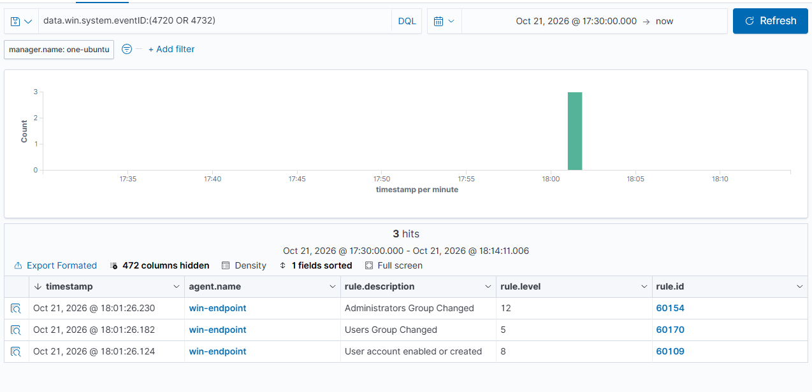

# Scenario 4 · Local Admin Account Created

| | |
| --- | --- |
| **MITRE ATT&CK** | [T1136.001](https://attack.mitre.org/techniques/T1136/001/) Create Account: Local Account · [T1098](https://attack.mitre.org/techniques/T1098/) Account Manipulation |
| **Target** | `win-endpoint` (Windows 11 Pro) |
| **Date** | 2026-10-21 |
| **Result** | ✅ Detected by built-in Wazuh rules, highest alert level 12 |

---

## Summary

A backdoor local account is one of the simplest persistence techniques: an attacker with admin rights creates a new user and adds it to **Administrators**, giving them a way back in even if the original foothold is removed. I simulated this on the endpoint, confirmed Windows logged it, and confirmed Wazuh raised alerts within a second, with the privilege escalation (admin group membership) correctly rated highest.

---

## Attack

Run in an elevated PowerShell on the endpoint (lab account, removed afterwards):

```powershell
net user labtest '<PASSWORD>' /add
net localgroup Administrators labtest /add
```

## Cleanup

```powershell
net user labtest /delete
```

---

## Timeline (Pacific Time)

| Time     | Source  | Event                                                   |
| -------- | ------- | ------------------------------------------------------- |
| 18:01:26 | Windows | **4720** User account `labtest` created by `Owner`      |
| 18:01:26 | Windows | **4732** `labtest` added to **Users** (automatic)       |
| 18:01:26 | Windows | **4732** `labtest` added to **Administrators**          |
| 18:01:26 | Wazuh   | Alerts 60109, 60170, 60154 raised (see below)           |
| 18:15:48 | Windows | **4726** User account `labtest` deleted by `Owner`      |
| 18:15:48 | Windows | **4733** `labtest` removed from Administrators and Users |

---

## Evidence

### Windows Security log

| Event ID | Meaning                          | Key fields                                           |
| -------- | -------------------------------- | ---------------------------------------------------- |
| 4720     | User account created             | `TargetUserName=labtest`, `SubjectUserName=Owner`    |
| 4732     | Member added to local group      | `TargetUserName=Administrators` / `Users`, `MemberSid=<new account SID>` |
| 4726     | User account deleted             | `TargetUserName=labtest`, `SubjectUserName=Owner`    |
| 4733     | Member removed from local group  | `TargetUserName=Administrators` / `Users`            |

Requires the **User Account Management** and **Security Group Management** audit subcategories ([guide 02](../docs/02-windows-logging.md)).

### Wazuh alerts

| Timestamp              | Rule ID | Level  | Description                     |
| ---------------------- | ------- | ------ | ------------------------------- |
| 18:01:26.124           | 60109   | 8      | User account enabled or created |
| 18:01:26.182           | 60170   | 5      | Users Group Changed             |
| 18:01:26.230           | 60154   | **12** | Administrators Group Changed    |

Dashboard (**Threat intelligence → Threat Hunting**): 3 alerts, 1 at level 12 or above. MITRE panel showed **Account Manipulation** and **Domain Policy Modification**.

Query used:
```
data.win.system.eventID:(4720 OR 4732)
```



---

## Detection

### Wazuh

No custom rule needed; the built-in Windows ruleset covers it:
- **60109** (level 8) on 4720 account creation
- **60154** (level 12) on 4732 when the group is Administrators
- **60170** (level 5) on 4732 for the Users group

### Sentinel (KQL, planned)

```kql
SecurityEvent
| where EventID in (4720, 4732)
| extend Group = iff(EventID == 4732, TargetUserName, "")
| where EventID == 4720 or Group =~ "Administrators"
| project TimeGenerated, Computer, EventID, Activity, SubjectUserName, TargetUserName, MemberSid
| order by TimeGenerated asc
```

---

## Analysis and Tuning

- **Every new account also produces a 4732 for Users.** Alerting on all group changes would double the noise. Wazuh already separates them (Users = level 5, Administrators = level 12), and a custom detection should key on the **Administrators** group (SID `S-1-5-32-544`), not on 4732 alone.
- **MITRE mapping is loose.** Wazuh tags rule 60154 as *Domain Policy Modification*, which describes domain-wide policy changes. For a local admin group on a single host, **T1098 Account Manipulation** and **T1136.001 Create Local Account** fit better. Worth knowing when reporting by technique.
- **Correlation idea:** 4720 followed within minutes by 4732 (Administrators) for the same account is a stronger signal than either alone. Candidate for a custom Wazuh rule with `<if_matched_sid>` and a timeframe.
- **Expected false positives:** IT admins creating accounts legitimately. In a real environment, allow-list known admin accounts or require a change ticket.

---

## Response (if this were real)

1. Confirm whether `SubjectUserName` (here `Owner`) intended the change.
2. If not: disable the new account, remove it from Administrators, and reset the creator's credentials.
3. Hunt for what else that session did (Sysmon 1 process creation, 4688, logons from the new account 4624).
