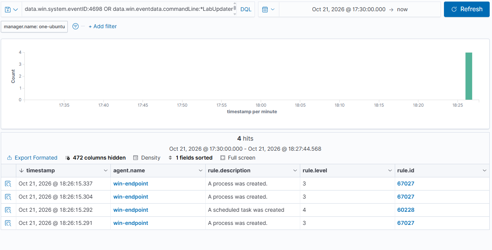
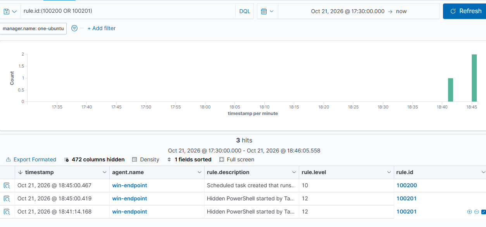

# Scenario 5 · Scheduled Task Persistence

| | |
| --- | --- |
| **MITRE ATT&CK** | [T1053.005](https://attack.mitre.org/techniques/T1053/005/) Scheduled Task/Job: Scheduled Task · [T1059.001](https://attack.mitre.org/techniques/T1059/001/) PowerShell |
| **Target** | `win-endpoint` (Windows 11 Pro) |
| **Date** | 2026-10-21 |
| **Result** | ⚠️ Default rules: seen but buried (level 3–4) → ✅ **two custom rules** raise level 10 and 12 |

---

## Summary

Attackers register scheduled tasks so their code runs again after reboots or logouts. I created a task with the usual attacker traits (bland name, hidden PowerShell window, runs as **SYSTEM**) and ran it once.

Wazuh's built-in rules logged it, but only at **level 3–4**, which would be lost among routine activity. Sysmon captured the most telling event (Task Scheduler launching hidden PowerShell as SYSTEM), yet no built-in rule alerted on it at all. I wrote two custom rules to close the gap, hit an encoding problem on the first deployment, fixed it, and re-ran the attack to confirm both rules fire.

---

## Attack

Elevated PowerShell on the endpoint. The "payload" only writes the date to a file.

```powershell
New-Item -ItemType Directory -Force C:\Temp | Out-Null

schtasks /create /tn "LabUpdater" /sc daily /st 23:59 /ru SYSTEM /f `
  /tr "powershell.exe -WindowStyle Hidden -Command Get-Date | Out-File C:\Temp\labtask.txt"

schtasks /run /tn "LabUpdater"
```

| Attacker trait     | In this task                        |
| ------------------ | ----------------------------------- |
| Innocuous name     | `LabUpdater`                        |
| Hidden execution   | `-WindowStyle Hidden`               |
| Highest privilege  | `/ru SYSTEM` (`S-1-5-18`)           |
| Script interpreter | `powershell.exe`                    |
| Immediate test run | `schtasks /run`                     |

## Cleanup

```powershell
schtasks /delete /tn "LabUpdater" /f
Remove-Item C:\Temp\labtask.txt
```

---

## Timeline (Pacific Time)

| Time     | Event                                                                                         |
| -------- | --------------------------------------------------------------------------------------------- |
| 18:26:15 | First run. **4698** task created; Sysmon **1** for `schtasks /create`, `schtasks /run`, and the hidden PowerShell. Wazuh: 60228 (L4) + 3× 67027 (L3) only |
| 18:26:16 | Payload ran: `C:\Temp\labtask.txt` written by SYSTEM                                           |
| ~18:30   | Gap identified; custom rules 100200 / 100201 written and tested against the captured event values |
| 18:32:42 | Re-run, but the rules had not reached the server yet (block pasted into the wrong shell). No custom alerts |
| ~18:40   | Rules deployed to the manager (`RULES OK`)                                                     |
| 18:41:14 | Re-run. **100201 fired (L12)**; 100200 did not                                                 |
| ~18:43   | Root cause: `taskContent` is HTML-encoded in Wazuh (`Command&gt;powershell.exe`); regex fixed and redeployed |
| 18:45:00 | Re-run. **100200 (L10) and 100201 (L12) both fired**                                           |
| 18:47:59 | Cleanup: **4699** task deleted; output file removed                                            |

---

## Evidence

### Windows / Sysmon (endpoint)

| Source        | Event | Key fields                                                                                   |
| ------------- | ----- | -------------------------------------------------------------------------------------------- |
| Security      | 4698  | `TaskName=\LabUpdater`, `SubjectUserName=Owner`, `TaskContent` → `<Command>powershell.exe</Command>`, `<UserId>S-1-5-18</UserId>` |
| Sysmon        | 1     | `schtasks.exe /create /tn LabUpdater ... /ru SYSTEM ...`, parent `pwsh.exe`, user `Owner`     |
| Sysmon        | 1     | `schtasks.exe /run /tn LabUpdater`                                                            |
| Sysmon        | 1     | **`powershell.exe -WindowStyle Hidden -Command ...`**, user **`NT AUTHORITY\SYSTEM`**, parent **`svchost.exe -k netsvcs -p`** |
| Security      | 4688  | Same three process launches with command lines                                               |
| Security      | 4699  | Task deleted (cleanup)                                                                       |

### Wazuh: built-in rules only (before)

| Rule  | Level | Description                   | Source event |
| ----- | ----- | ----------------------------- | ------------ |
| 60228 | 4     | A scheduled task was created  | 4698         |
| 67027 | 3     | A process was created. (×3)   | 4688         |

The Sysmon process events matched only level-0 rules, so they produced **no alerts**.



### Wazuh: with custom rules (after)

| Timestamp    | Rule       | Level  | Description                                                                 |
| ------------ | ---------- | ------ | --------------------------------------------------------------------------- |
| 18:45:00.467 | **100200** | **10** | Scheduled task created that runs a script interpreter: `\LabUpdater`        |
| 18:45:00.419 | **100201** | **12** | Hidden PowerShell started by Task Scheduler as `NT AUTHORITY\SYSTEM`: `"powershell.exe" -WindowStyle Hidden -Command Get-Date \| Out-File C:\Temp\labtask.txt` |
| 18:41:14.168 | 100201     | 12     | (same, from the first post-deployment run)                                  |



---

## Detection

### Wazuh custom rules ([`rules/local_rules.xml`](../rules/local_rules.xml))

```xml
<group name="local,windows,persistence,">

  <!-- Escalate built-in 60228 (4698, level 4) when the task runs a script interpreter.
       taskContent arrives HTML-encoded (Command&gt;powershell.exe), so "Command.{1,4}?" covers "&gt;" and ">". -->
  <rule id="100200" level="10">
    <if_sid>60228</if_sid>
    <field name="win.eventdata.taskContent" type="pcre2">(?i)Command.{1,4}?"?([^;"\s]*\\)?(powershell|pwsh|cmd|wscript|cscript|mshta|rundll32|regsvr32)(\.exe)?\b</field>
    <description>Scheduled task created that runs a script interpreter: $(win.eventdata.taskName)</description>
    <mitre><id>T1053.005</id></mitre>
  </rule>

  <!-- Sysmon 1: hidden PowerShell launched by the Task Scheduler service host (built-in: level 0). -->
  <rule id="100201" level="12">
    <if_group>sysmon_event1</if_group>
    <field name="win.eventdata.image" type="pcre2">(?i)\\(powershell|pwsh)\.exe$</field>
    <field name="win.eventdata.parentImage" type="pcre2">(?i)\\svchost\.exe$</field>
    <field name="win.eventdata.parentCommandLine" type="pcre2">(?i)-k\s+netsvcs</field>
    <field name="win.eventdata.commandLine" type="pcre2">(?i)-w(indowstyle)?\s+h(idden)?\b</field>
    <description>Hidden PowerShell started by Task Scheduler as $(win.eventdata.user): $(win.eventdata.commandLine)</description>
    <mitre><id>T1053.005</id><id>T1059.001</id></mitre>
  </rule>

</group>
```

**Why two rules:** 100200 catches the task at **creation** (Windows audit log, works without Sysmon). 100201 catches it at **execution** (Sysmon), which also covers tasks created by means that skip a 4698, and fires every time the task runs.

**Deploying:** appended to `/var/ossec/etc/rules/local_rules.xml` on the manager, validated with `wazuh-analysisd -t`, then `systemctl restart wazuh-manager`.

### Sentinel (KQL, planned)

```kql
SecurityEvent
| where EventID == 4698
| extend TaskContent = tostring(EventData)
| where TaskContent has_any ("powershell", "pwsh", "cmd.exe", "wscript", "cscript", "mshta", "rundll32", "regsvr32")
| project TimeGenerated, Computer, SubjectUserName, TaskContent
```

---

## Analysis and Tuning

- **Detection gap in defaults.** Out of the box, Wazuh saw every step but scored them as routine (level 3–4), and Sysmon's most valuable event produced no alert. Without custom rules, an analyst would likely miss this.
- **Test against real data, not the docs.** Rule 100200 was written against the raw Windows event, where the task XML reads `<Command>powershell.exe</Command>`. Wazuh stores that field **HTML-encoded** (`&lt;Command&gt;powershell.exe&lt;/Command&gt;`), so the first version never matched. Pulling the actual alert from `/var/ossec/logs/alerts/alerts.json` showed the real format; the fix was a pattern that tolerates both.
- **Verify deployment, not just the rule.** The first re-run produced nothing because the rule block had been pasted into the wrong shell. `grep -c` for the rule IDs on the manager settled it in seconds.
- **Expected false positives:**
  - 100200: admin or software-installer tasks that legitimately run `cmd`/PowerShell. Tune by excluding known task paths (e.g. `\Microsoft\Windows\`) or signed vendor tasks.
  - 100201: very few. Hidden PowerShell from Task Scheduler is rare on a workstation; any legitimate one is worth allow-listing by exact command line.
- **Possible extensions:** raise 100200 further when `<UserId>S-1-5-18</UserId>` (SYSTEM) is present; add a 4698 → Sysmon 1 correlation within a short timeframe; watch Sysmon 11/13 for files written under `C:\Windows\System32\Tasks\`.

---

## Response (if this were real)

1. Identify the task (`\LabUpdater`), its creator (`SubjectUserName`), and what it runs (`TaskContent` → `Command` / `Arguments`).
2. Disable and export the task for evidence: `schtasks /query /tn <name> /xml`, then `schtasks /delete`.
3. Collect what the payload touched (Sysmon 1, 3, 11 from the SYSTEM PowerShell process).
4. Investigate how the creator account got admin rights; reset its credentials if compromised.
