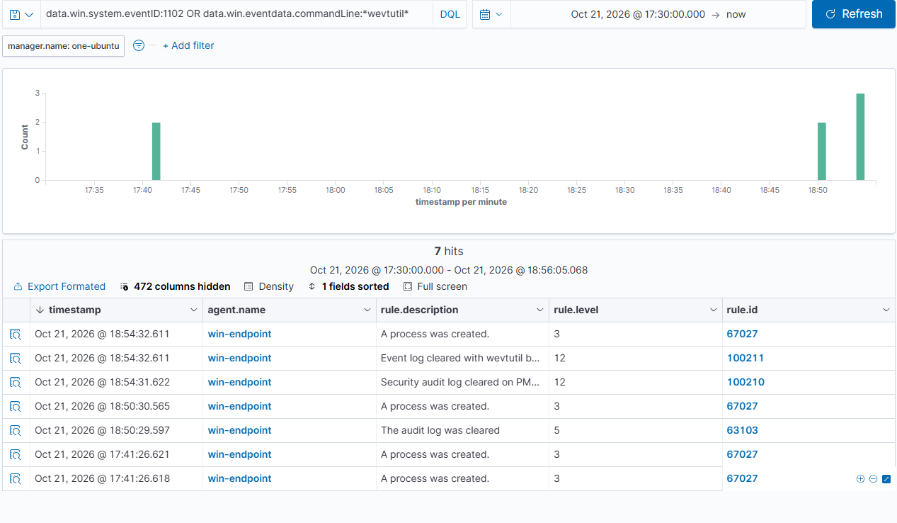

# Scenario 6 · Security Log Cleared

| | |
| --- | --- |
| **MITRE ATT&CK** | [T1070.001](https://attack.mitre.org/techniques/T1070/001/) Indicator Removal: Clear Windows Event Logs |
| **Target** | `win-endpoint` (Windows 11 Pro) |
| **Date** | 2026-10-21 |
| **Result** | ⚠️ Default rules: level 5 → ✅ **custom rules** raise two level-12 alerts |

---

## Summary

Attackers clear the Windows Security log to erase evidence of what they did. Windows can't stop an administrator from clearing it, but it always writes **Event 1102** as the first entry of the emptied log. I cleared the log with `wevtutil`, the standard tool, and checked what survived and what Wazuh made of it.

Two things worked in the defender's favour: the **Wazuh agent had already shipped** the earlier events to the server, and **Sysmon's own log was untouched**, still recording the exact command that did the wiping. But Wazuh's built-in rule rated the clear at only **level 5**. Two custom rules now raise it to **level 12** from both angles.

---

## Attack

Elevated PowerShell on the endpoint:

```powershell
wevtutil cl Security /bu:C:\Temp\Security-before-clear.evtx
```

`cl` = clear-log. The `/bu:` backup is a lab safety net (attackers skip it); it doesn't change what gets logged. No output on success.

## Cleanup

Nothing to undo; the backups were deleted afterwards:
```powershell
Remove-Item C:\Temp\Security-before-clear*.evtx
```

---

## Timeline (Pacific Time)

| Time     | Event                                                                                  |
| -------- | -------------------------------------------------------------------------------------- |
| 17:41:26 | (Earlier, unrelated) `wevtutil gl Security` run during logging setup: read-only, Wazuh 67027 L3 ×2 |
| 18:50:29 | First run. **1102** audit log cleared by `Owner`; Sysmon **1** `wevtutil.exe cl Security`. Wazuh: **63103 L5**, 67027 L3 |
| ~18:52   | Gap identified; custom rules 100210–100212 written and regex-tested against the real command lines |
| ~18:53   | Rules deployed to the manager (`RULES OK`)                                              |
| 18:54:31 | Second run. **100210 (L12)** on Event 1102                                              |
| 18:54:32 | **100211 (L12)** on Sysmon 1 `wevtutil.exe cl Security`                                 |

---

## Evidence

### Endpoint

| Source   | Event | Key fields                                                                              |
| -------- | ----- | --------------------------------------------------------------------------------------- |
| Security | 1102  | `SubjectUserName=Owner`; the **first entry** in the emptied log |
| Sysmon   | 1     | `"C:\WINDOWS\system32\wevtutil.exe" cl Security /bu:...`, user `Owner`, parent `pwsh.exe` |
| Security | 4688  | Same process launch (written just after the clear)                                       |

Sysmon writes to `Microsoft-Windows-Sysmon/Operational`, a separate log, so clearing Security left it intact. An attacker would need to clear it too, which is itself a detectable event.

### Wazuh

| Timestamp    | Rule       | Level  | Description                                                                     |
| ------------ | ---------- | ------ | ------------------------------------------------------------------------------- |
| 18:50:29.597 | 63103      | 5      | The audit log was cleared *(built-in, first run)*                               |
| 18:50:30.565 | 67027      | 3      | A process was created. *(4688 for wevtutil)*                                    |
| 18:54:31.622 | **100210** | **12** | Security audit log cleared on `<HOSTNAME>` (Event 1102)                        |
| 18:54:32.611 | **100211** | **12** | Event log cleared with wevtutil by `Owner`: `wevtutil.exe cl Security /bu:...` |
| 18:54:32.611 | 67027      | 3      | A process was created.                                                          |

On the second run, 100210 replaced 63103: a child rule that matches takes over from its parent.

Query used:
```
data.win.system.eventID:1102 OR data.win.eventdata.commandLine:*wevtutil*
```



---

## Detection

### Wazuh custom rules ([`rules/local_rules.xml`](../rules/local_rules.xml))

```xml
<group name="local,windows,defense_evasion,">

  <!-- Escalate built-in 63103 (Event 1102, level 5). -->
  <rule id="100210" level="12">
    <if_sid>63103</if_sid>
    <description>Security audit log cleared on $(win.system.computer) (Event 1102)</description>
    <mitre><id>T1070.001</id></mitre>
  </rule>

  <!-- Sysmon 1: wevtutil clearing any log. Only "cl" / "clear-log", not "gl", "epl", etc. -->
  <rule id="100211" level="12">
    <if_group>sysmon_event1</if_group>
    <field name="win.eventdata.image" type="pcre2">(?i)\\wevtutil\.exe$</field>
    <field name="win.eventdata.commandLine" type="pcre2">(?i)\s(cl|clear-log)\s+\S</field>
    <description>Event log cleared with wevtutil by $(win.eventdata.user): $(win.eventdata.commandLine)</description>
    <mitre><id>T1070.001</id></mitre>
  </rule>

  <!-- Sysmon 1: PowerShell clearing a log. -->
  <rule id="100212" level="12">
    <if_group>sysmon_event1</if_group>
    <field name="win.eventdata.image" type="pcre2">(?i)\\(powershell|pwsh)\.exe$</field>
    <field name="win.eventdata.commandLine" type="pcre2">(?i)(Clear-EventLog|Remove-EventLog|\.ClearLog\(|wevtutil(\.exe)?\s+(cl|clear-log)\s)</field>
    <description>Event log cleared with PowerShell by $(win.eventdata.user): $(win.eventdata.commandLine)</description>
    <mitre><id>T1070.001</id><id>T1059.001</id></mitre>
  </rule>

</group>
```

**Why three rules:**
- **100210** works from the Windows audit log alone, no Sysmon needed, and catches any clearing method.
- **100211** names the tool, the user, and the exact log, and also covers clearing *other* logs (System, Sysmon) that don't produce a 1102.
- **100212** covers the PowerShell route (`Clear-EventLog`). Not exercised in this run; regex-tested only.

### Sentinel (KQL, planned)

```kql
SecurityEvent
| where EventID == 1102
| project TimeGenerated, Computer, Activity, SubjectUserName = tostring(parse_xml(EventData).UserData.LogFileCleared.SubjectUserName)
```

---

## Analysis and Tuning

- **Severity gap in defaults.** A cleared Security log is one of the highest-signal events on Windows, yet the built-in rule scored it level 5, below the account-creation alert in Scenario 4.
- **Central collection is the real defence.** The agent forwards events within seconds, so the attacker's wipe destroyed only the local copy. Everything from Scenarios 4 and 5 is still on the Wazuh server.
- **Precision matters.** Earlier in the day, a harmless `wevtutil gl Security` (read the log's settings) ran during setup. A rule on "any wevtutil" would have alerted on it; matching only `cl` / `clear-log` keeps it quiet.
- **Expected false positives:** planned log maintenance or imaging scripts. Allow-list by account and change window, never by turning the rule down.
- **Extensions to consider:**
  - Event **104** (System log cleared) and a Sysmon-log clear: 100211 already covers `wevtutil cl System` / `cl Microsoft-Windows-Sysmon/Operational` at the process level.
  - Sysmon service stopped or uninstalled (Sysmon Event 4 / service state change) as a related evasion signal.
  - Correlate 1102 with privileged logon (4672) from the same account in the preceding minutes.

---

## Response (if this were real)

1. Treat as an active intrusion: someone with admin rights is hiding activity.
2. Identify the account from 1102 / Sysmon 1 and the parent process (`pwsh.exe` here), and what launched that.
3. Reconstruct the missing history from the **SIEM copy** (Wazuh) and from logs the attacker didn't clear (Sysmon, PowerShell 4104).
4. Isolate the host, reset the account's credentials, and review other hosts that account touched.
